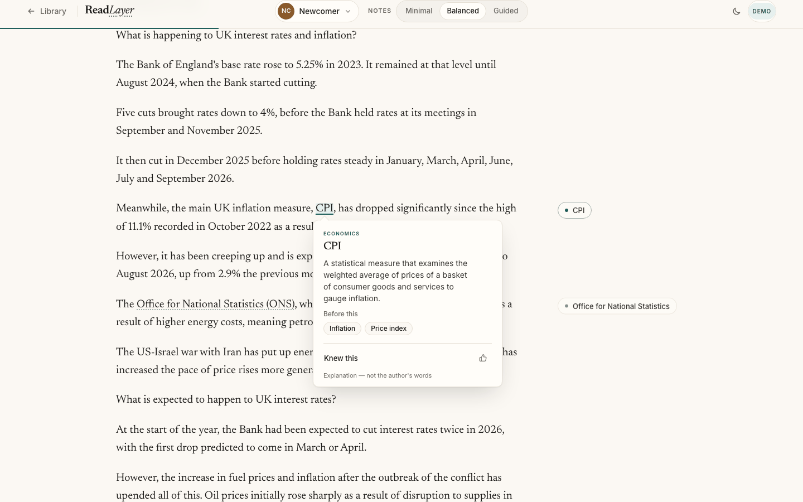
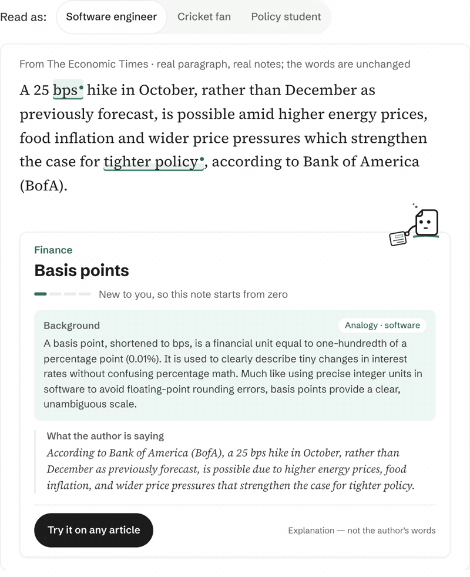
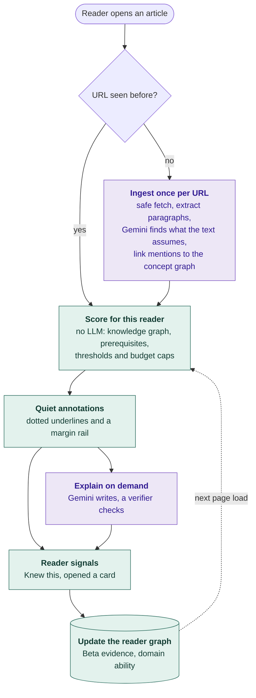
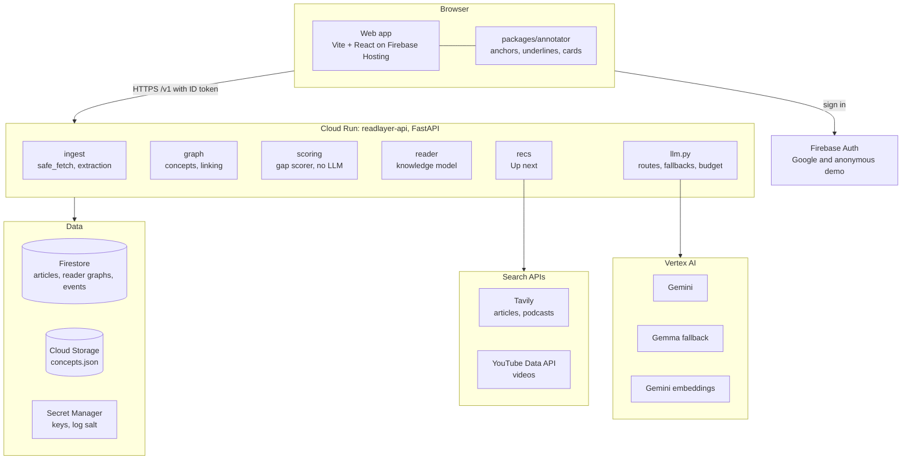
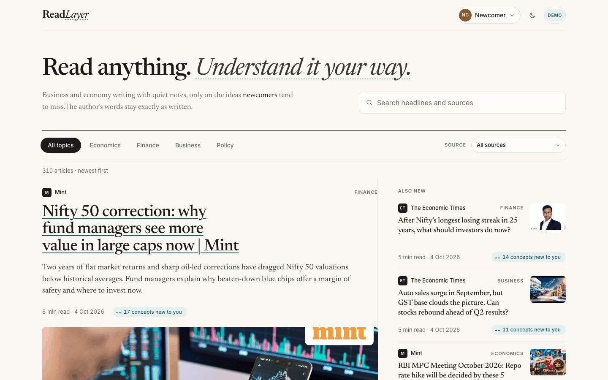
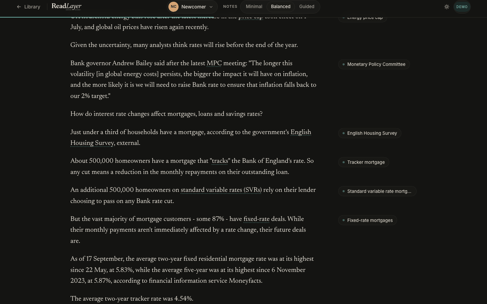
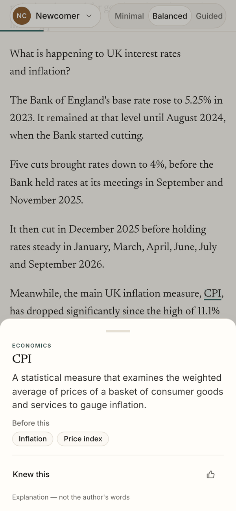

<div align="center">

<picture>
  <source media="(prefers-color-scheme: dark)" srcset="docs/images/wordmark-dark.png">
  
</picture>

### Read anything. Understand it your way.

<sub>Gloss was called ReadLayer until the Design pass; the repository, URLs and internal ids keep the old name.</sub>

[](https://github.com/SOURABHMISHRA5221/readlayer/actions/workflows/ci.yml)
[](https://cloud.google.com/)
[](https://cloud.google.com/vertex-ai)
[](https://cloud.google.com/run)
[](LICENSE)

[**Live demo**](https://glossreader.web.app) · [How it works](#how-it-works) · [Architecture](#architecture) · [Evaluation](#evaluation)

</div>

<br>

## Why Gloss

Every article, video and podcast is made once, for an imagined average reader. Real readers differ in what they know, the words they're at ease with and the worlds they think in. Today they struggle silently, leave the page to search, or ask an AI to summarise, which replaces the author's voice instead of supporting it.

## Our goals

1. **Understanding without rewriting.** The original stays untouched; help is a personal overlay on the author's words.
2. **Personal, not generic.** Explain only what *this* reader will likely miss, in their frame: an engineer and a commerce student get different analogies.
3. **Quieter over time.** Each reader's graph learns from every interaction, so notes fade as understanding grows. Success means less help is needed.
4. **Trustworthy by design.** Explanations are checked against the source before they're shown; readers can see, correct, export or delete what we hold.
5. **Every format, one reader.** Articles first, then videos and podcasts through the same reader graph.

## Design principles

- **Content is immutable.**
- **No LLM on the per-reader scoring path.**
- **Privacy by default:** no reader data goes to models or search.
- **Restraint over noise.**



## See it


<sub>The same passage of a live article for the three demo readers. The newcomer gets four notes; the markets trader, strong in finance, gets one; the policy student gets the three mortgage terms but not the government survey. Across all 310 articles in the library, the trader and the policy student get identical underlines on only 8.</sub>

<div align="center">
  
</div>

## Features

| Feature | What it does |
|---|---|
| **Personal gap detection** | Scores every concept, term and reference in an article against the reader's own knowledge, then shows only the few most likely to be missed, at most one note per 80 words. |
| **Reader knowledge graph** | Each reader has a graph of what they know: Beta-distributed confidence per concept, ability per domain, and forgetting with a 90-day half-life. "Knew this" removes a note on the next load and nudges related concepts. |
| **Explanations in your own frame** | Cards give the concept's definition and the prerequisites to read first; two-part explanations ("Background" and "What the author is saying") use analogies from the reader's own field.† |
| **Up next, across formats** | Recommends what to read, watch or listen to next: library articles (the same story elsewhere, primers for a weak prerequisite, deeper reads), plus web articles and podcasts (Tavily) and videos (YouTube Data API). |
| **Privacy and data rights** | No user identifiers or reading history ever reach a model or a search provider. Export everything we hold, or delete it along with the account, from the account menu. |
| **Accessibility** | Keyboard-reachable cards with ARIA roles and a focus trap, a bottom sheet on phones, light and dark themes, and a Lighthouse accessibility score of 100 on the reader. |

<sub>† In progress; see [Where we are](#where-we-are).</sub>

## How it works

Ingestion runs once per URL and is shared by every reader. Scoring runs on every page view, for one reader, with no model call: it is deterministic math over the reader's graph, so the same reader and article always get the same notes.



<sub>Purple steps call a model; green steps never do. Explanations are in progress; see [Where we are](#where-we-are).</sub>

The scorer, in short (full formulas in [DESIGN §5–6](docs/DESIGN.md#5-scoring-per-reader-deterministic)):

- **How likely the reader knows a concept**: their own evidence for it (fading toward a prior over time), or an item-response prior from their ability in that domain and the concept's difficulty. A concept can't be known much better than its best-known prerequisite.
- **How much a miss matters**: the chance of missing it times how central it is to the paragraph, discounted when the article explains it in its own words.
- **What gets shown**: a threshold set by the reader's density choice (minimal, balanced or guided) and adapted by their own behaviour; then budget caps per word count and per paragraph, and each concept only at its first occurrence.

## Architecture



| Google Cloud service | What it does here |
|---|---|
| **Cloud Run** | Runs the FastAPI service in asia-south1, scaling from 0 to at most 3 instances. |
| **Vertex AI** | Gemini for extraction, linking and explanations; Gemma as a pay-per-token fallback; Gemini embeddings for concept linking. |
| **Firestore** | Article demand profiles, per-reader graphs and events (raw events expire after 90 days), the LLM spend ledger and usage caps. Clients have no direct access. |
| **Cloud Storage** | The concept graph file, loaded into memory when the API starts. |
| **Firebase Auth and Hosting** | Google sign-in and anonymous demo sessions; hosting for the web app. |
| **Secret Manager** | The log-pseudonymisation salt and the search API keys. |
| **Cloud Build** | Builds the API image from source on each deploy. |

## How Gen AI is used

Every model call goes through one module, [`app/llm.py`](apps/api/app/llm.py), backed by the LiteLLM SDK. It gives each named task a primary model and a fallback, structured output validated against a schema, retries, per-call cost logging, and a hard daily budget. Model IDs come from environment variables, never from code. Prompts are versioned files in [`app/prompts/`](apps/api/app/prompts).

| Task | Model | Why |
|---|---|---|
| `extract_demands`: what each paragraph assumes the reader knows | Gemini 3.5 Flash-Lite, Gemma 4 fallback | Runs once per new article; the fast tier keeps a new article at about two cents of model cost |
| `link_confirm`: is this mention really that concept? | Gemini 3.8 Flash | Measured 97% precision against the 95% target; the fast tier reached 89% |
| `link_merge`, `concept_define`, `concept_prereqs`, `concept_wikidata` | Gemini 3.5 Flash-Lite, Gemma 4 fallback | Building and growing the concept graph |
| `embed`: concept and mention vectors | Gemini embedding 001, 256 dimensions | Nearest-concept candidates for linking |
| `explain` and `verify`† | Gemini 3.8 Flash | User-visible prose and the faithfulness check deserve the stronger model |

<sub>† In progress; see [Where we are](#where-we-are).</sub>

**Where we deliberately use no model:** the per-reader scoring path behind every page view, the library list, recommendation ranking and the reading-profile summary. These are deterministic, so they are fast, cheap and testable, and the same input always gives the same result.

## Evaluation

Measured results so far. Each number comes from [docs/STATUS.md](docs/STATUS.md), where the method behind it is recorded.

| What | Result |
|---|---|
| Concept graph | 5,206 concepts in 14 domains (the business core plus politics, law, technology, science, health, environment, sports, culture, education, society), seeded from Wikipedia glossaries and grown online from new articles; no cycles |
| Library | 310 articles, each ingested once and shared by every reader |
| Linking on unseen articles | 30 held-out articles: frozen graph links 64% of business and 13% of non-business concept mentions (targets 75% / 60% missed); with online growth, as in production, 89% / 66%. Grown concepts judged correct by the build agent (Sourabh's audit pending): 87% (first sample), 97% (after tightening, overlapping the first), 90% on a fresh sample of 30 grown live ([report](apps/api/evals/heldout_report.md)) |
| Readers see different notes | Trader and policy student get identical underlines on **8 of 310** articles (mean overlap 0.15) |
| Scoring latency, p95 | **0.19 ms** for a 1,200-word article (local test); 1.6 ms on Cloud Run (the API's own rolling window, Oct 14); budget 150 ms |
| Annotations endpoint, p95 on Cloud Run | **478 ms** (median 98 ms) over 213 requests, Oct 8–14, from the request logs; includes cold starts, since the service scales to zero ([ops report](apps/api/evals/ops_report.md)) |
| Accessibility | Lighthouse accessibility **100** on the reader, layout shift 0 |
| Model cost per new article | Median **$0.0045** to analyse a library article (361 pages to date), plus about $0.0014 when it grows new concepts; explanation parts about $0.004 each, and 70% of explanation requests are served from the cache ([ops report](apps/api/evals/ops_report.md)) |
| Total model spend to date | **$22.64** on the project ledger (Oct 4–14), most of it building the library and concept graph and running evals; page views cost nothing in model calls |

## Responsible AI and privacy

- **The author's words are never changed.** Notes are an overlay anchored to exact quotes in the text; nothing is rewritten or summarised, and cards are labelled "Explanation — not the author's words".
- **Every explanation is verified.**† It must pass deterministic checks (numbers, hedges, attribution and negations preserved) and a Gemini entailment judge before it is shown or cached; otherwise the card falls back to the plain definition.
- **Article text is untrusted.** It goes to models inside delimiters, models get no tools, and every response is validated against a schema.
- **No personal data in prompts or searches.** Models and search providers receive content and concept data only, never user ids, emails or reading history. This is covered by tests. Logs carry a pseudonymous hash instead of a user id.
- **Your data, your call.** Export everything we hold as JSON, or delete it together with the account. Raw interaction events expire after 90 days, and Firestore rules deny all direct client access.
- **Safe fetching.** Every user-supplied URL goes through `safe_fetch`. It allows only http and https on ports 80 and 443, rejects private, loopback, link-local and metadata addresses and re-checks them after every redirect, enforces a 10-second timeout and a 3 MB cap, and respects robots.txt.
- **Cost guards.** A daily LLM budget is enforced in code. Each reader can add at most 20 new URLs a day. Demo sessions get tighter limits, plus shared daily caps so creating accounts can't multiply them. Cloud Run is capped at 3 instances.

<sub>† In progress; see [Where we are](#where-we-are).</sub>

## Screenshots

<table>
  <tr>
    <td width="62%" valign="top">
      
      <p align="center"><sub>Library: each story shows how many concepts are new to you</sub></p>
      
      <p align="center"><sub>Dark theme</sub></p>
    </td>
    <td width="38%" valign="top">
      
      <p align="center"><sub>On a phone, cards open as a bottom sheet</sub></p>
    </td>
  </tr>
</table>

## Getting started

**Prerequisites**

- Node.js 22 and pnpm 12
- Python 3.12+ with [uv](https://docs.astral.sh/uv/)
- Google Cloud SDK
- Java 21, for the emulator tests only
- A Google Cloud project with Vertex AI, Firestore (Native mode), Cloud Storage, Secret Manager and Firebase enabled
- Firebase Auth with the Google and Anonymous providers turned on

The Makefile names our project and account at the top (`PROJECT`, `ACCOUNT`, `REGION`); change them for your own. Cloud targets check the active gcloud identity before doing anything.

```bash
git clone https://github.com/SOURABHMISHRA5221/readlayer.git
cd readlayer
pnpm install
(cd apps/api && uv sync)

gcloud auth application-default login
cp apps/api/.env.example apps/api/.env   # then fill in the values
make web-config                           # writes the web app's Firebase config
make dev                                  # API on :8000, web on :5173
```

**Configuration** (names only; see [`apps/api/.env.example`](apps/api/.env.example)):

| Group | Variables |
|---|---|
| Runtime | `ENV`, `LOG_LEVEL`, `GCP_PROJECT`, `VERTEX_LOCATION`, `CORS_ORIGINS` |
| Models | `MODEL_FAST`, `MODEL_QUALITY`, `MODEL_FALLBACK`, `MODEL_EMBED`, `EMBED_DIM`, `MODEL_PRICE_OVERRIDES` |
| Concept graph | `CONCEPTS_URI`, `LINK_THRESHOLD`, `DEDUPE_THRESHOLD` |
| Guardrails | `LLM_DAILY_BUDGET_USD`, `LLM_TIMEOUT_S`, `LLM_MAX_RETRIES`, `INGEST_DAILY_CAP`, `ANON_INGEST_DAILY_CAP`, `ANON_GLOBAL_INGEST_DAILY_CAP`, `ANON_SEARCH_DAILY_CAP`, `SEARCH_DAILY_CAP`, `YOUTUBE_SEARCH_DAILY_CAP` |
| Secrets (Secret Manager in production) | `UID_HASH_SALT`, `TAVILY_API_KEY`, `YOUTUBE_API_KEY` |
| Web app (written by `make web-config`) | `VITE_FIREBASE_API_KEY`, `VITE_FIREBASE_AUTH_DOMAIN`, `VITE_FIREBASE_PROJECT_ID`, `VITE_FIREBASE_APP_ID`, `VITE_API_BASE` |
| Extension (committed, public: `apps/extension/.env.production`, `.env.emulator`) | `VITE_API_BASE`, `VITE_WEB_BASE`, `VITE_WEB_ORIGINS`, `VITE_USE_EMULATORS` |

**Tests**

```bash
make test             # ruff, pytest, TypeScript typecheck and package tests
make test-emulator    # export and delete against the Firestore and Auth emulators
```

### Install the extension locally

Gloss also runs on any news page through a Chrome extension. It isn't on the Chrome Web Store; you load it unpacked. It asks for `activeTab`, `scripting` and `storage` only: no access to any site until you click it, and it never reads mail, banking or private pages, or a page with a password or card field.

1. Get it: download `gloss-extension.zip` from the [latest release](https://github.com/SOURABHMISHRA5221/readlayer/releases/latest) (0.8.2 or later; 0.8.1 connects only from the earlier address) and unzip it, or build it yourself with `pnpm install && pnpm --filter extension build` (writes `apps/extension/dist`; no cloud access needed: the build settings in `apps/extension/.env.production` are public, and the web app hands the extension its sign-in when you connect).
2. Open `chrome://extensions`, turn on **Developer mode**, choose **Load unpacked** and pick the unzipped folder (or `apps/extension/dist`).
3. Pin Gloss to the toolbar.
4. In the web app, open your account menu → **Use Gloss on any site** and press **Connect** (a demo session connects as its sample reader).
5. Open a news article and click Gloss in the toolbar, then **Read this page** (or press Alt+Shift+R). On a YouTube video, the same button is **Open in Gloss**: the video opens in the web app with a transcript and notes (videos up to 10 minutes).

The extension sends only the article's title and paragraphs (on YouTube, only the video's link, with any playlist, time or tracking parameters removed), after removing emails, phone numbers, card numbers, Aadhaar and PAN numbers in your browser. A page you bring in is visible only to you.

## Repository structure

```text
readlayer/
├── apps/
│   ├── api/                 FastAPI service (Python 3.12, uv)
│   │   ├── app/
│   │   │   ├── ingest/      safe_fetch, extraction, demand profiles
│   │   │   ├── graph/       concept graph, linking, overrides
│   │   │   ├── reader/      knowledge model, personas, events
│   │   │   ├── scoring/     gap scorer and annotation budget (no LLM)
│   │   │   ├── recs/        Up next: library, web search, ranking
│   │   │   ├── explain/     explanations and verifier
│   │   │   ├── me/          reader graph, profile, export, delete
│   │   │   ├── store/       Firestore repositories
│   │   │   ├── prompts/     versioned prompt files
│   │   │   └── llm.py       the one gateway to every model
│   │   ├── scripts/         corpus ingestion, graph build, persona seeding
│   │   └── tests/
│   ├── web/                 Vite + React reader and library
│   └── extension/           Chrome MV3 client
├── packages/
│   └── annotator/           framework-free annotation layer shared by web and extension
├── docs/                    DESIGN, BUILD_PLAN, STATUS, images
├── data/                    corpus URL lists and graph overrides
├── firestore.rules          deny all client access
└── Makefile                 dev, test and guarded deploy targets
```

## Where we are

**Built and live (M0–M4).** These are running at [glossreader.web.app](https://glossreader.web.app) (the earlier address, readlayer-sourabh-26.web.app, serves the same app):
- safe ingestion and the concept graph (5,206 concepts in 14 domains, growing online);
- the reader knowledge model, with Google and demo sign-in, export and delete;
- the deterministic gap scorer, and three seeded demo personas that learn from "Knew this";
- the annotator, library and reader;
- Up next recommendations across articles, videos and podcasts.

Today a card shows the concept's definition and its prerequisites.

**In progress (M5): verified explanations.**
- Two-part explanations: "Background", plus a restatement of what the author is saying.
- The faithfulness verifier that gates every explanation.
- Safety evals, including prompt-injection cases.

**Next.**
- **Rest of M6:** paragraph notes, the pre-read path and "Know this?" prompts. The API already computes them.
- **M2.2:** open domains and online concept growth (done); frozen-graph linking on unseen articles stays below target, see the held-out report.
- **M7:** onboarding and the reading profile page. Readers will see and correct their graph there; the API for it exists. This is also where the reader's own analogy domain is set.
- **M8 (done):** the Gloss Chrome extension, live; see "Install the extension locally".
- **M9:** growth slots taken when used, quality fixes to online growth, cost / cache / latency report, monitoring dashboard.

**Beyond the hackathon.** Videos and podcasts appear today as recommendations only; annotating them is outside the hackathon scope ([DESIGN §14](docs/DESIGN.md#14-out-of-scope-for-the-hackathon)).

## Roadmap

- [x] M0–M2.1: scaffold, LLM gateway, safe ingestion, 3,327-concept graph
- [x] M3: reader model, Google and demo sign-in, data rights, first deploy
- [x] M4: real gap scorer, seeded demo personas, closed learning loop
- [x] M6 slice: annotator, library, reader, Up next recommendations
- [ ] M5: two-part explanations, faithfulness verifier, safety evals
- [ ] M6: paragraph notes, pre-read path, "Know this?" prompts, "This is wrong"
- [x] M2.2: 14 domains, glossary seeding, online concept growth, jurisdiction-aware linking (frozen-graph targets missed and reported)
- [ ] M7: onboarding, calibration and the reading profile page
- [x] M8: Chrome extension with client-side redaction
- [ ] M9: growth and quality fixes, cost / cache / latency report, hardening, demo video

## Team

| Name | Role | Links |
|---|---|---|
| _Team member 1: full name_ | _Role_ | _GitHub · LinkedIn_ |
| _Team member 2: full name_ | _Role_ | _GitHub · LinkedIn_ |

## License

[MIT](LICENSE)

## Acknowledgements

Built for the **Google Cloud AI Builder Cup 2026** (Media, Content and Digital Experiences). Articles in the demo library belong to their publishers; ReadLayer links to them and never alters their text. Thanks to Google Cloud for Vertex AI, Cloud Run, Firestore and Firebase, and to the open-source projects this builds on, including FastAPI, LiteLLM, trafilatura, spaCy, networkx, React, Vite and Floating UI.
