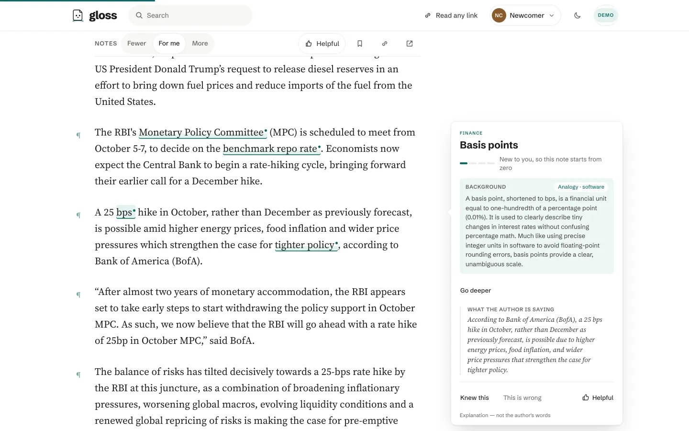
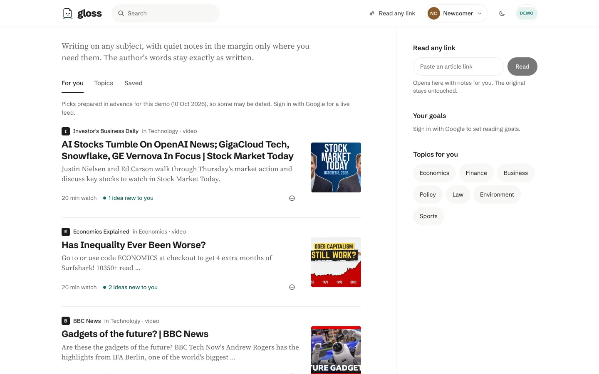
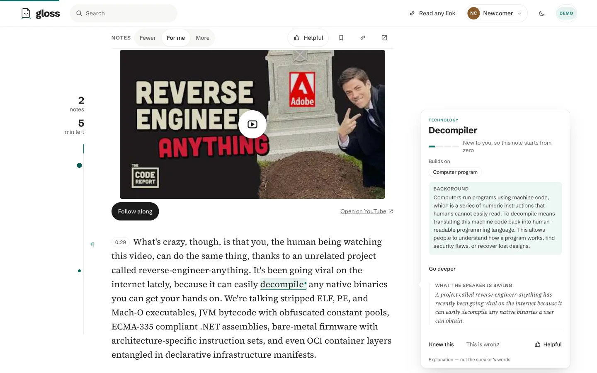
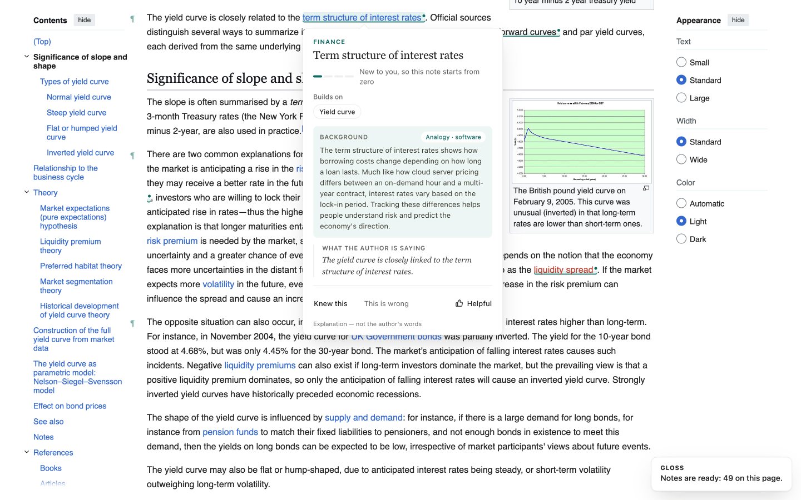
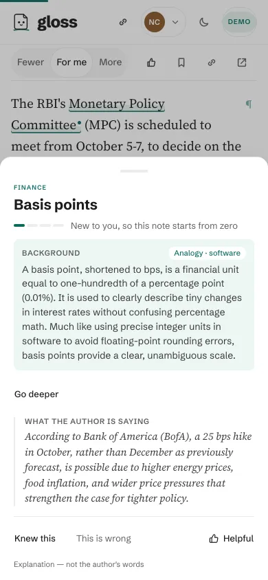
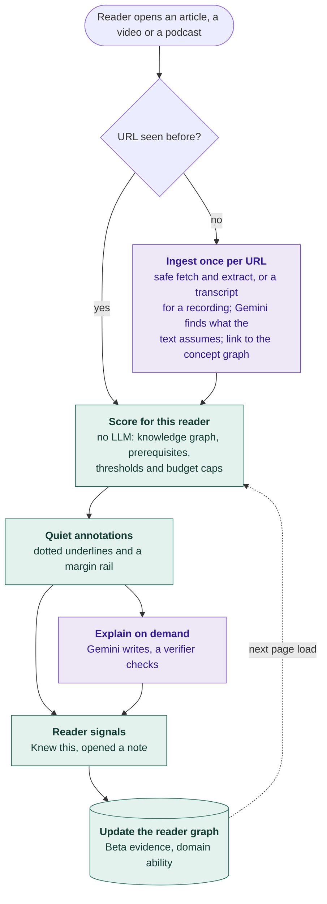
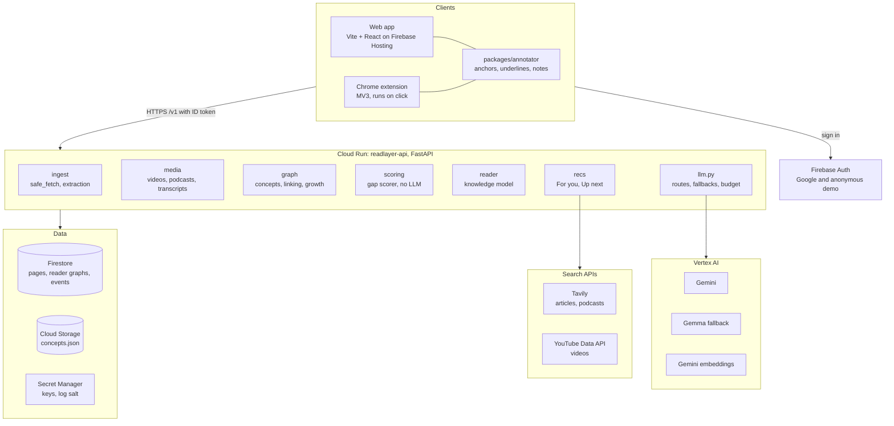

<div align="center">

<picture>
  <source media="(prefers-color-scheme: dark)" srcset="docs/images/wordmark-dark.png">
  
</picture>

### Consume anything. Understand it your way.

<sub>Gloss was called ReadLayer until the Design pass; the repository, the API and internal ids keep the old name.</sub>

[](https://github.com/SOURABHMISHRA5221/readlayer/actions/workflows/ci.yml)
[](https://cloud.google.com/)
[](https://cloud.google.com/vertex-ai)
[](https://cloud.google.com/run)
[](LICENSE)

[**Live demo**](https://glossreader.web.app) · [**Demo video**](https://youtu.be/49zoxUwdK1k) · [Chrome extension](#install-the-extension) · [How it works](#how-it-works) · [Architecture](#architecture) · [Evaluation](#evaluation)

</div>

<br>

## Why Gloss

Every article, video and podcast is made once, for an imagined average reader. Real readers differ in what they know, the words they're at ease with and the worlds they think in. Today they struggle silently, leave the page to search, or ask an AI to summarise, which replaces the author's voice instead of supporting it.

## Our goals

1. **Understanding without rewriting.** The original stays untouched; help is a personal overlay on the author's words.
2. **Personal, not generic.** Explain only what *this* reader will likely miss, in their frame: an engineer and a commerce student get different analogies.
3. **Quieter over time.** Each reader's graph learns from every interaction, so notes fade as understanding grows. Success means less help is needed.
4. **Trustworthy by design.** Explanations are checked against the source before they're shown; readers can see, correct, export or delete what we hold.
5. **Every format, one reader.** Articles, short videos and podcast episodes, through the same reader graph.

## Design principles

- **Content is immutable.**
- **No LLM on the per-reader scoring path.**
- **Privacy by default:** no identity or record of what you consume goes to models or search.
- **Restraint over noise.**

<!-- The stills below are the landing page's own (apps/web/public/landing/). If the landing renames
     or replaces them, re-run the README link check. -->


## See it

![The same Economic Times paragraph about a 25 bps rate hike, read as three demo readers. Software engineer: bps and tighter policy are marked, and the note on Basis points starts from zero with a software analogy. Cricket fan: tighter policy is marked and bps is a quiet refresher; the note on Monetary tightening skips the basics, lists Monetary policy and Central bank as what it builds on, and uses a cricket analogy. Policy student: only bps is marked, and its note skips the basics with a law analogy. Each note ends with What the author is saying, in italics.](docs/images/three-readers.png)

<sub>One real paragraph from The Economic Times, with real notes from the pipeline (verified, from the landing's demo), read as the three demo readers, each named for the field its analogies come from. The software engineer gets two new terms, and the note on basis points starts from zero. The cricket fan (the markets-trader reader) already knows basis points, so that's only a quiet refresher, and its note is on monetary tightening. The policy student gets basis points alone, pitched as "heard of". Measured on Oct 5 across the 310 corpus articles, the trader and the policy student got identical underlines on only 8.</sub>

<div align="center">
  
</div>

## Features

| Feature | What it does |
|---|---|
| **Personal gap detection** | Scores every concept, term and reference in a page against the reader's own knowledge, then marks only the few they're most likely to miss, at most one note per 80 words. |
| **Notes in your own frame** | Each note has two labelled parts: **Background**, using analogies from the reader's own field, and **What the author is saying**, a restatement that keeps the source's hedges, attribution, numbers and negations. Both pass a faithfulness check before they're shown. |
| **Paragraph notes and pre-read** | A paragraph that assumes a lot gets a marker with a short explainer; a page that leans on ideas the reader lacks opens with a pre-read of what to know first. "Know this?" prompts check a single term. |
| **Reader knowledge graph** | Each reader has a graph of what they know: Beta-distributed confidence per concept, ability per domain, and forgetting with a 90-day half-life. "Knew this" removes a note on the next load and nudges related concepts; "This is wrong" removes a bad explanation for everyone. |
| **Onboarding and profile** | Two short screens: your field and the topics you follow (in your own words too, if you like), then real articles, videos and podcasts to like or skip (taste only), plus an optional quick check on a few terms; your field and country set a starting level, and read / watch / listen orders your suggestions. The profile shows your knowledge map, which you can correct in plain words ("I know options trading well"; you see the change before it applies), plus goals and a weekly view. |
| **For you, with readiness** | A feed picked for your topics from top outlets, refreshed twice a day (demo readers see a prepared snapshot), with a line per pick from your own map: "Mostly familiar", "Ready for you", or "A stretch: read up on X first". |
| **Open any link, any format** | Paste an article, a YouTube video (up to 10 minutes) or an Apple Podcasts episode (up to 12): it opens with notes. Videos and podcasts get a transcript with a time button on each paragraph. Longer ones open where they play. |
| **Up next** | What to read, watch or listen to next: library articles (the same story elsewhere, primers for a weak prerequisite, deeper reads), plus web articles and podcasts (Tavily) and videos (YouTube Data API). |
| **Chrome extension** | The same notes on any news page, at your click only; on a YouTube video it opens the video in Gloss. See [Install the extension](#install-the-extension). |
| **Privacy and data rights** | No user identifiers or record of what people consume ever reach a model or a search provider. Export everything we hold, or delete it along with the account, from the account menu. |
| **Accessibility** | Keyboard-reachable notes with ARIA roles and a focus trap, a sheet on phones, light and dark themes, and axe finds no serious or critical issues on the library, reader and profile (after the redesign, Oct 11). |

## Screenshots

<table>
  <tr>
    <td width="62%" valign="top">
      
      <p align="center"><sub>For you, with a readiness line on each pick</sub></p>
      
      <p align="center"><sub>A short video: transcript with time buttons, and a note</sub></p>
      
      <p align="center"><sub>The Chrome extension on Wikipedia</sub></p>
    </td>
    <td width="38%" valign="top">
      
      <p align="center"><sub>On a phone, notes open as a sheet</sub></p>
    </td>
  </tr>
</table>

## How it works

Ingestion runs once per URL and is shared by every reader. Scoring runs on every page view, for one reader, with no model call: it is deterministic math over the reader's graph, so the same reader and page always get the same notes.



<sub>Purple steps call a model; green steps never do.</sub>

The scorer, in short (full formulas in [DESIGN §5–6](docs/DESIGN.md#5-scoring-per-reader-deterministic)):

- **How likely the reader knows a concept**: their own evidence for it (fading toward a prior over time), or an item-response prior from their ability in that domain and the concept's difficulty. A concept can't be known much better than its best-known prerequisite.
- **How much a miss matters**: the chance of missing it times how central it is to the paragraph, discounted when the article explains it in its own words.
- **What gets shown**: a threshold set by the reader's density choice (fewer, balanced or more) and adapted by their own behaviour; then budget caps per word count and per paragraph, and each concept only at its first occurrence.

## Architecture



| Google Cloud service | What it does here |
|---|---|
| **Cloud Run** | Runs the FastAPI service in asia-south1, scaling from 0 to at most 3 instances. Cloud Scheduler calls it twice a day to refresh the For you picks. |
| **Vertex AI** | Gemini for extraction, linking, explanations, verification and transcripts; Gemma as a pay-per-token fallback; Gemini embeddings for concept linking. |
| **Firestore** | Page demand profiles, transcripts, per-reader graphs and events (raw events expire after 90 days), the LLM spend ledger and usage caps. Clients have no direct access. |
| **Cloud Storage** | The concept graph file, loaded into memory when the API starts. |
| **Firebase Auth and Hosting** | Google sign-in and anonymous demo sessions; hosting for the web app at [glossreader.web.app](https://glossreader.web.app). |
| **Secret Manager** | The log-pseudonymisation salt and the search API keys. |
| **Cloud Build** | Builds the API image from source on each deploy. |

## How Gen AI is used

Every model call goes through one module, [`app/llm.py`](apps/api/app/llm.py), backed by the LiteLLM SDK. It gives each named task a primary model and a fallback, structured output validated against a schema, retries, per-call cost logging, and a hard daily budget. Model IDs come from environment variables, never from code. Prompts are versioned files in [`app/prompts/`](apps/api/app/prompts).

| Task | Model | Why |
|---|---|---|
| `extract_demands`: what each paragraph assumes the reader knows | Gemini 3.5 Flash-Lite, Gemma 4 fallback | Runs once per new page; the fast tier keeps a new article at about half a cent of model cost |
| `link_confirm`: is this mention really that concept? | Gemini 3.8 Flash | Met the 95% precision target on the M2 alias set, where the fast tier reached 89%; falls back to Gemini 3.5 Flash-Lite. Also matches the reader's onboarding words and goal phrases, as redacted pieces, one piece per call |
| `link_merge`, `concept_define`, `concept_prereqs`, `concept_wikidata`, `concept_jurisdiction` | Gemini 3.5 Flash-Lite, Gemma 4 fallback | Building and growing the concept graph |
| `embed`: concept and mention vectors | Gemini embedding 001, 256 dimensions | Nearest-concept candidates for linking; also the reader's redacted onboarding pieces and goal phrases, one piece per request |
| `explain` (Background) and `restate` (What the author is saying) | Gemini 3.8 Flash, Gemini 3.5 Flash-Lite fallback | User-visible prose deserves the stronger model |
| `verify` and `verify_background`: the faithfulness judge | Gemini 3.8 Flash (the judge model setting, unset in production, falls back to it) | Each claim must be entailed by the source; no fallback: if the judge fails, the note shows the plain definition |
| `transcribe`: a short video or podcast episode to text | Gemini 3.8 Flash | The fast tier dropped a third of the speech on a measured window |
| `profile_edit`: "I know options trading well", "Describe yourself" | Gemini 3.5 Flash-Lite, Gemma 4 fallback | Turns the reader's words into a few typed edits, previewed before anything is applied |

<sub>The landing page's illustrations were made once, offline, with an image model (`landing_art`); no image model runs in the product.</sub>

**Where we deliberately use no model:** the per-reader scoring path behind every page view, the library and feed lists, recommendation ranking, readiness lines and the profile summary. These are deterministic, so they are fast, cheap and testable, and the same input always gives the same result.

## Evaluation

Each number comes from [docs/STATUS.md](docs/STATUS.md) or a report in [`apps/api/evals/`](apps/api/evals), where the method behind it is recorded.

| What | Result |
|---|---|
| Faithfulness and safety ([report](apps/api/evals/report.md)) | Run of Oct 10 on the live prompts (restate-v2, explain-v5, verify-v2, verify-background-v1), judge Gemini 3.8 Flash: **15/15** adversarial notes rejected (dropped hedges, dropped attribution, changed numbers, flipped negations, opinion as fact); **24/25** good notes accepted (one rejected); **10/10** prompt-injection cases safe; Background suite 3/3 rejected and 2/2 accepted; non-business notes 6/7 (outside the targets) |
| Concept graph | **5,206** concepts in 14 domains (the business core plus politics, law, technology, science, health, environment, sports, culture, education, society): 3,327 from the article corpus plus 1,874 from Wikipedia glossaries, merged; **5,281** served on Oct 14 after growing online from new pages; no cycles |
| Library | **323** library pages analysed, each ingested once and shared by every reader ([ops report](apps/api/evals/ops_report.md)) |
| Linking on unseen articles | 30 held-out articles: frozen graph links 64% of business and 13% of non-business concept mentions (targets 75% / 60%, set for the frozen graph: missed); with online growth, as in production, 89% / 66%, which includes concepts grown from the measured articles themselves, so never the headline. Grown concepts judged correct by the build agent (human audit pending): 87% (first sample), 97% (after tightening, overlapping the first), 90% on a fresh sample of 30 grown live ([report](apps/api/evals/heldout_report.md)) |
| Readers see different notes | Measured Oct 5 on the 310 corpus articles: the trader and the policy student get identical underlines on **8 of 310** (mean overlap 0.15) |
| Scoring latency, p95 | **0.19 ms** for a 1,200-word article (local test); 1.6 ms on Cloud Run (the API's own rolling window, Oct 14); budget 150 ms |
| Annotations endpoint, p95 on Cloud Run | **478 ms** (median 98 ms) over 213 requests, Oct 8–14, from the request logs; includes cold starts, since the service scales to zero ([ops report](apps/api/evals/ops_report.md)) |
| Accessibility | After the redesign (Oct 11): axe **0** serious or critical issues on the library, reader and profile, no horizontal scroll at 390 px; the landing scores Lighthouse accessibility **100** with axe 0 at every impact level |
| Model cost per new article | Median **$0.0045** to analyse a library article (323 library pages; 361 stored in all); pages readers bring in add a median of about $0.0014 for growing new concepts; explanation parts about $0.004 each, and 70% of explanation requests are served from the cache ([ops report](apps/api/evals/ops_report.md)) |
| Total model spend to date | **$22.64** on the project ledger (Oct 4–14), most of it building the library and concept graph and running evals; page views cost nothing in model calls |

## Responsible AI and privacy

- **The author's words are never changed.** Notes are an overlay anchored to exact quotes in the text; nothing is rewritten or summarised, and each note is labelled as an explanation, not the author's words.
- **Every explanation is verified.** It must pass deterministic checks (numbers, hedges, attribution and negations preserved) and a Gemini entailment judge before it is shown or cached; otherwise the note falls back to the plain definition. A reader's "This is wrong" removes it from the cache.
- **Page text is untrusted.** It goes to models inside delimiters, models get no tools, and every response is validated against a schema.
- **No personal data in prompts or searches.** Models get page and concept content and, for profile edits, goals and onboarding, the reader's own words with emails, phone and card numbers removed first; never user ids, emails or what they consume. Search providers get concept and topic labels (and fixed phrases) and, for the end-of-article story, the title of a library article or of a page opened from Gloss's own suggestions (never extension text, never a link the reader was never shown), never anything the reader typed; a pasted video or podcast link is looked up by its id. This is covered by tests. Logs carry a pseudonymous hash instead of a user id.
- **Transcripts** are made from the public recording only, with nothing about the reader. They are made automatically and can contain errors; the recording is the source.
- **Your data, your call.** Export everything we hold as JSON, or delete it together with the account. Raw interaction events expire after 90 days, and Firestore rules deny all direct client access.
- **Safe fetching.** Every user-supplied URL goes through `safe_fetch`. It allows only http and https on ports 80 and 443, rejects private, loopback, link-local and metadata addresses and re-checks them after every redirect, enforces a 10-second timeout and a 3 MB cap, and respects robots.txt.
- **Cost guards.** A daily LLM budget of $8 is enforced in code. Each reader can add at most 20 new links a day (a demo reader 3) and open 5 new videos or podcasts a day (a demo reader 1); videos are capped at 10 minutes and podcasts at 12. Demo sessions share further daily caps, so creating accounts can't multiply them. Cloud Run is capped at 3 instances.

## Getting started

**Prerequisites**

- Node.js 22 and pnpm 12
- Python 3.12+ with [uv](https://docs.astral.sh/uv/)
- Google Cloud SDK
- Java 21, for the emulator tests only
- A Google Cloud project with Vertex AI, Firestore (Native mode), Cloud Storage, Secret Manager and Firebase enabled
- Firebase Auth with the Google and Anonymous providers turned on

The Makefile names our project and region at the top (`PROJECT`, `REGION`); change them for your own. Your gcloud account goes in a gitignored file, `.gcp.local.mk`, containing one line: `ACCOUNT := you@example.com`. The Makefile keeps its own gcloud config folder (`CLOUDSDK_CONFIG=~/.config/gcloud-readlayer`) and reads credentials from it, so sign in there; cloud targets check that identity and project before doing anything. `make web-config` expects a Firebase web app named `readlayer-web` and `make test-emulator` a Java 21 path; override either on the command line (`make web-config WEB_APP=my-app`, `make test-emulator JAVA21=/path/to/jdk21`).

```bash
git clone https://github.com/SOURABHMISHRA5221/readlayer.git
cd readlayer
pnpm install
(cd apps/api && uv sync)

echo 'ACCOUNT := you@example.com' > .gcp.local.mk   # your gcloud account
export CLOUDSDK_CONFIG=$HOME/.config/gcloud-readlayer   # the folder the Makefile uses
gcloud auth login
gcloud config set project YOUR_PROJECT_ID
gcloud auth application-default login
cp apps/api/.env.example apps/api/.env             # then fill in the values
make web-config                                     # writes the web app's Firebase config
make dev                                            # API on :8000, web on :5173
```

**Configuration** (names only; see [`apps/api/.env.example`](apps/api/.env.example)):

| Group | Variables |
|---|---|
| Runtime | `ENV`, `LOG_LEVEL`, `GCP_PROJECT`, `VERTEX_LOCATION`, `CORS_ORIGINS` |
| Models | `MODEL_FAST`, `MODEL_QUALITY`, `MODEL_FALLBACK`, `MODEL_JUDGE`, `MODEL_EMBED`, `EMBED_DIM`, `MODEL_PRICE_OVERRIDES` |
| Concept graph | `CONCEPTS_URI`, `LINK_THRESHOLD`, `DEDUPE_THRESHOLD` |
| Guardrails | `LLM_DAILY_BUDGET_USD`, `LLM_TIMEOUT_S`, `LLM_MAX_RETRIES`, `INGEST_DAILY_CAP`, `ANON_INGEST_DAILY_CAP`, `ANON_GLOBAL_INGEST_DAILY_CAP`, `ANON_SEARCH_DAILY_CAP`, `SEARCH_DAILY_CAP`, `YOUTUBE_SEARCH_DAILY_CAP` |
| Growth and media (defaults in [`app/config.py`](apps/api/app/config.py); growth is off locally) | `GROWTH_ENABLED`, `MEDIA_ENABLED`, `MEDIA_VIDEO_ENABLED`, `MEDIA_AUDIO_ENABLED`, `MEDIA_MAX_VIDEO_S`, `MEDIA_MAX_AUDIO_S`, `MEDIA_DAILY_CAP` |
| Secrets (Secret Manager in production) | `UID_HASH_SALT`, `TAVILY_API_KEY`, `YOUTUBE_API_KEY` |
| Web app (written by `make web-config`) | `VITE_FIREBASE_API_KEY`, `VITE_FIREBASE_AUTH_DOMAIN`, `VITE_FIREBASE_PROJECT_ID`, `VITE_FIREBASE_APP_ID`, `VITE_API_BASE` |
| Extension (committed, public: `apps/extension/.env.production`, `.env.emulator`) | `VITE_API_BASE`, `VITE_WEB_BASE`, `VITE_WEB_ORIGINS`, `VITE_USE_EMULATORS` |

**Tests**

```bash
make test             # ruff, pytest, TypeScript typecheck and package tests
make test-emulator    # export and delete against the Firestore and Auth emulators
```

### Install the extension

Gloss also runs on any news page through a Chrome extension. It isn't on the Chrome Web Store: you load it unpacked in Chrome (other Chromium browsers are untested). It asks for `activeTab`, `scripting` and `storage` only: it has no access to any site until you click it, and then only to that tab. It never reads mail, banking, sign-in or private pages, or a page with a password or card field.

1. Download `gloss-extension.zip` from the [latest release](https://github.com/SOURABHMISHRA5221/readlayer/releases/latest) and unzip it.
2. In `chrome://extensions`, turn on **Developer mode**, choose **Load unpacked** and pick the folder; then pin Gloss from the puzzle-piece menu.
3. In Gloss, open your account menu, choose **Use Gloss on any site**, then **Connect** (a demo session works).
4. Open a news article, click Gloss in the toolbar (or press Alt+Shift+R), then **Read this page**.

On a YouTube video the popup's button is **Open in Gloss** instead: the video opens in the web app with a transcript and notes (videos up to 10 minutes). To build the extension yourself, run `pnpm install && pnpm --filter extension build` and load `apps/extension/dist`; the build needs no cloud access, since its settings in `apps/extension/.env.production` are public and the web app hands it your sign-in when you connect. Version 0.8.1 connects only from the earlier address; use 0.8.2 or later.

The extension sends only the article's title and paragraphs (on YouTube, only the video's link, with any playlist, time or tracking parameters removed). Emails, phone, card, Aadhaar and PAN numbers are removed on your device before the text is sent. An article page you bring in is visible only to you. A YouTube video opened from the extension is stored like any video pasted into Gloss: anyone with its link can read it, and only the entry in your library is yours.

## Repository structure

```text
readlayer/
├── apps/
│   ├── api/                 FastAPI service (Python 3.12, uv)
│   │   ├── app/
│   │   │   ├── ingest/      safe_fetch, extraction, demand profiles
│   │   │   ├── media/       videos and podcasts: links, lookups, audio, transcripts
│   │   │   ├── content/     page access, the library catalogue, summaries
│   │   │   ├── graph/       concept graph, linking, online growth, overrides
│   │   │   ├── reader/      knowledge model, personas, events
│   │   │   ├── scoring/     gap scorer and annotation budget (no LLM)
│   │   │   ├── recs/        For you, Up next, web search, ranking
│   │   │   ├── explain/     explanations and verifier
│   │   │   ├── me/          reader graph, profile, goals, export, delete
│   │   │   ├── privacy/     redaction of anything a reader types
│   │   │   ├── store/       Firestore repositories
│   │   │   ├── prompts/     versioned prompt files
│   │   │   └── llm.py       the one gateway to every model
│   │   ├── evals/           safety, linking and ops reports
│   │   ├── scripts/         corpus ingestion, graph build, persona and feed seeding
│   │   └── tests/
│   ├── web/                 Vite + React: landing, library, For you, reader, profile
│   └── extension/           Chrome MV3 client
├── packages/
│   └── annotator/           framework-free annotation layer shared by web and extension
├── tools/shots/             screenshot, accessibility and live-check harnesses (dev only)
├── docs/                    DESIGN, BUILD_PLAN, STATUS, plans, evidence, images
├── data/                    corpus URL lists, glossaries and graph overrides
├── firestore.rules          deny all client access
└── Makefile                 dev, test and guarded deploy targets
```

## Status

**Live at [glossreader.web.app](https://glossreader.web.app)**, built in milestones; each one's acceptance checks are recorded in [docs/STATUS.md](docs/STATUS.md).

- [x] M0–M2.1: scaffold, LLM gateway, safe ingestion, first concept graph
- [x] M2.2: 14 domains, glossary seeding, online concept growth, jurisdiction-aware linking (frozen-graph linking targets missed and reported)
- [x] M3: reader model, Google and demo sign-in, data rights, first deploy
- [x] M4: real gap scorer, seeded demo personas, closed learning loop
- [x] M5: two-part explanations, faithfulness verifier, safety evals
- [x] M6: annotator, library, reader, Up next; paragraph notes, pre-read, "Know this?", "This is wrong"
- [x] M7 and M7.5: onboarding and calibration, the reading profile with its knowledge map, For you, Read any link, reading goals
- [x] Design pass, landing and onboarding: the Gloss name and look; wide layouts
- [x] M8: Chrome extension with on-device redaction; Open in Gloss on YouTube (0.8.2)
- [x] Media: short YouTube videos and Apple Podcasts episodes with transcripts and notes
- [x] M9: growth and quality fixes, cost / cache / latency report, monitoring dashboard, hardening
- [x] Readiness lines on For you
- [x] Demo video ([watch on YouTube](https://youtu.be/49zoxUwdK1k)) and deck

**Limits, honestly.** Built and evaluated on English; videos and podcasts must be English (others are refused). Videos are capped at 10 minutes and podcast episodes at 12; longer ones open where they play. Linking on unseen articles missed its targets, which were set for the frozen graph (64% and 13% against 75% and 60%); with online growth, as in production, it reaches 89% and 66%, but that figure includes concepts grown from the measured articles themselves, so it is not the headline (see Evaluation). The grown-concept precision figures were judged by the build agent and await a human audit.

## License

[MIT](LICENSE)

## Acknowledgements

Built for the **Google Cloud AI Builder Cup 2026** (Media, Content and Digital Experiences). Articles, videos and podcasts in the demo belong to their publishers; Gloss links to them and never alters them. Thanks to Google Cloud for Vertex AI, Cloud Run, Firestore and Firebase, and to the open-source projects this builds on, including FastAPI, LiteLLM, trafilatura, spaCy, networkx, React, Vite and Floating UI.
